<picture>
  <source media="(prefers-color-scheme: dark)" srcset="docs/screenshots/hero-dark.webp">
  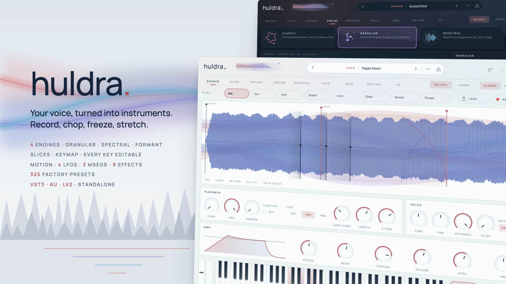
</picture>

# Huldra

A sound design sampler for every common DAW – VST3, Audio Unit, LV2 and a standalone app. Load or record your voice
(or anything else), and turn it into keys, pads, choirs, plucks and vocal chops: four engines (classic, granular,
spectral and a formant-keeping vocal engine), automatic slicing, a keymap for many sounds at once, every key editable
on its own, deep modulation, a motion engine that can play by itself, fifteen effects and 325 factory presets.
*Huldra* is the forest spirit of Nordic folklore whose voice lures you into the woods; it is the third instrument from
Fjord and shares its Scandinavian, minimal interface (light and dark).

[](https://github.com/fjord-sounds/huldra/actions/workflows/ci.yml)
[](LICENSE)

> **Made with AI.** Huldra – the plugin code, the user interface, the tests and all factory presets – was written
> entirely by AI with Claude Opus, directed by prompts. Nothing is hand-programmed or hand-tuned.
> The code is open so you can read it, test it and judge for yourself; bug reports and pull requests are welcome.

<p>
  <a href="#a-tour">Tour</a> ·
  <a href="#engines">Engines</a> ·
  <a href="#effects">Effects</a> ·
  <a href="#presets">Presets</a> ·
  <a href="#building">Building</a> ·
  <a href="#tests">Tests</a>
</p>

## Your sound, your instrument

- **Drop, record, play.** Drop audio files anywhere on the window (WAV, AIFF, FLAC, OGG, MP3, M4A, CAF). One file
  replaces the sound; several files are analysed and spread over the keyboard by their pitch. Or press **Record**:
  Huldra records the track input (side-chain in your DAW, the microphone in the standalone app), optionally starting
  when a signal arrives.
- **It listens first.** Every sound is analysed when it arrives: its pitch (a YIN tracker, so a sung note is mapped
  to the right key, in tune to the cent), its melody over time, its transients and syllables, its spectrum.
- **Presets are treatments.** A preset never contains audio: it is a way of playing *your* sound. Loading one keeps
  what you recorded. Until you load something, eight synthesized demo voices (aah, ooh, hum, breath, choir, glass,
  bowed and a sung phrase) let you hear every preset.
- **Saved with the project.** Your sounds are embedded in the project (lossless FLAC), so a session opens anywhere.
- **Resample in place.** *Bounce* renders the sound as you hear it – engine, motion, effects – into a new sample and
  plays that. Then do it again: granular through spectral through tape.

## Works in your DAW

| Format | Platforms | Hosts (examples) |
|---|---|---|
| **VST3** | macOS, Windows, Linux | Ableton Live, Bitwig Studio, Cubase, FL Studio, Studio One, Reaper, Ardour |
| **AU** | macOS | Logic Pro, GarageBand, MainStage |
| **LV2** | Linux | Ardour, Carla, Qtractor |
| **Standalone** | macOS, Windows, Linux | no DAW needed – records from your microphone |

- **Automation**: every knob is a host parameter (272 of them). Keymaps, slices, per-key edits, MSEG shapes, the step
  pattern and the spectral mask are saved with the project and – except the sounds themselves – in presets.
- **MPE**: pitch bend, pressure and slide (CC 74) per note, as modulation sources.
- **Tempo sync**: LFOs, delays and the motion engine follow the host tempo and song position; with the host stopped,
  the motion engine runs at its own tempo.
- **Any block size and sample rate**: oversized host blocks are split internally; sounds at any sample rate are played
  back in tune.
- **Drag to DAW**: drag the *DRAG WAV* tile from the footer onto a track to get the current sound (C3, two seconds
  plus its tail) as a 24-bit WAV.

## A tour

### Source

<picture>
  <source media="(prefers-color-scheme: dark)" srcset="docs/screenshots/source-dark.webp">
  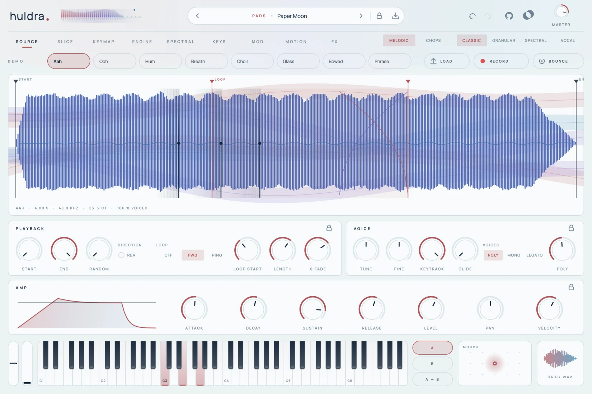
</picture>

Your sounds as chips at the top, with *Load*, *Record* and *Bounce*. Below, the active sound: a waveform coloured by
its brightness, the detected melody as a thin line, and draggable markers for start, end and the loop – with the
crossfade drawn as two curves. Every playing voice leaves a glowing playhead. Behind it all, veils of light move with
what you play. Underneath: playback (start, end, random start, reverse, forward or ping-pong loops), the voice
(tune, keytracking, glide, poly / mono / legato) and the amp envelope.

### Slice

<picture>
  <source media="(prefers-color-scheme: dark)" srcset="docs/screenshots/slice-dark.webp">
  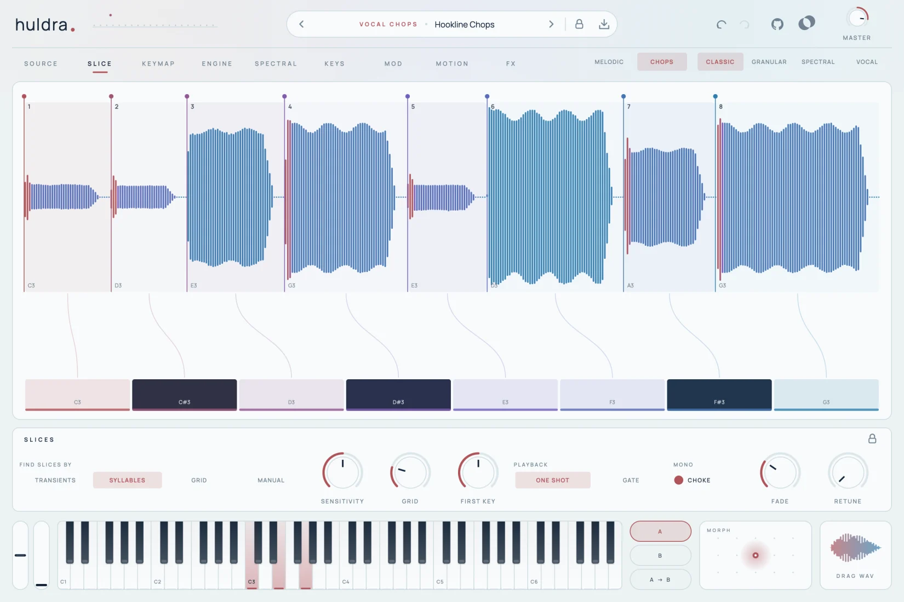
</picture>

Vocal chops. Huldra finds slices by **transients**, by **syllables** (dips in the loudness of a voice) or on a
**grid**; any edit switches to **manual** markers you can add, drag and delete. Threads lead from every slice to the
key that plays it and light up when it sounds. Each slice shows the note it was sung on – *Retune* pulls it into the
key. One-shot or gated, with choke (a new chop cuts the last one) and a fade against clicks.

### Keymap

<picture>
  <source media="(prefers-color-scheme: dark)" srcset="docs/screenshots/keymap-dark.webp">
  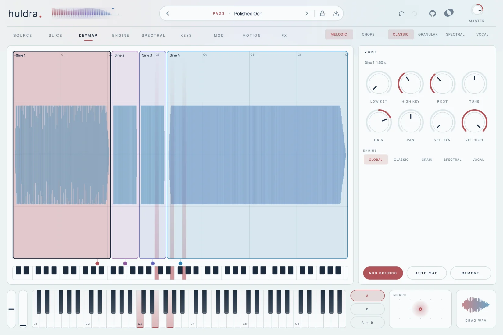
</picture>

Several sounds over the keyboard and the velocity range. Drag a zone to move it, its edges to resize it, the dot on
the keys to set its root. Each zone has its own tuning, gain, pan and engine. *Auto map* spreads all sounds by their
detected pitch; unpitched sounds (drums, noises) land on single keys.

### Engine

<picture>
  <source media="(prefers-color-scheme: dark)" srcset="docs/screenshots/engine-dark.webp">
  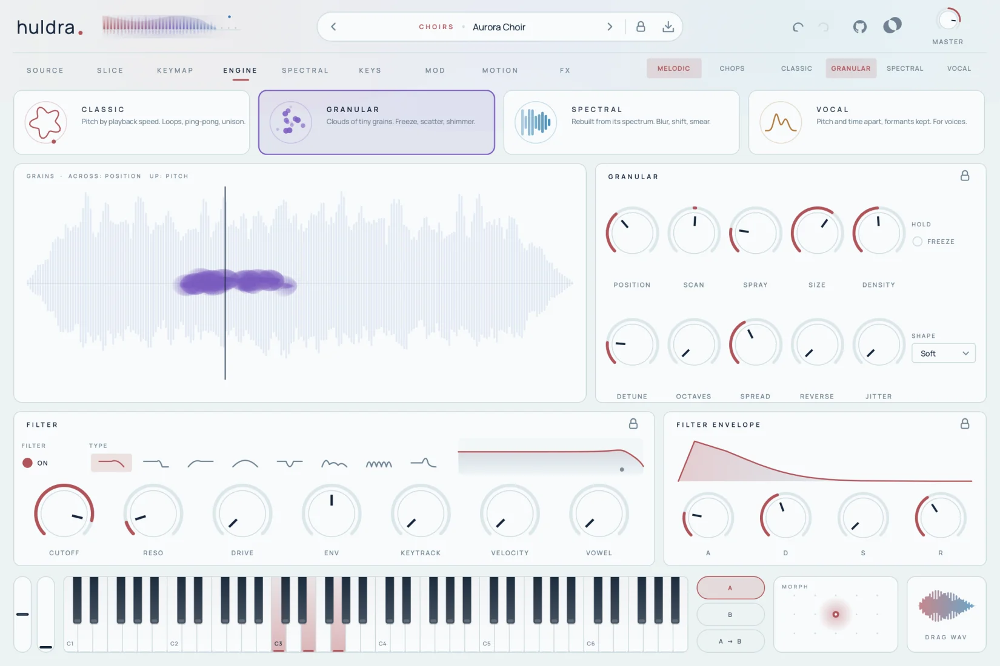
</picture>

Four engines, each with its own picture: **classic** draws the sound as a ring with the playheads orbiting it;
**granular** shows every grain as a glowing dot (where it comes from, how high it plays); **spectral** shows the
frame being played; **vocal** shows the formants of the voice and where the formant shift moves them.

<picture>
  <source media="(prefers-color-scheme: dark)" srcset="docs/screenshots/vocal-dark.webp">
  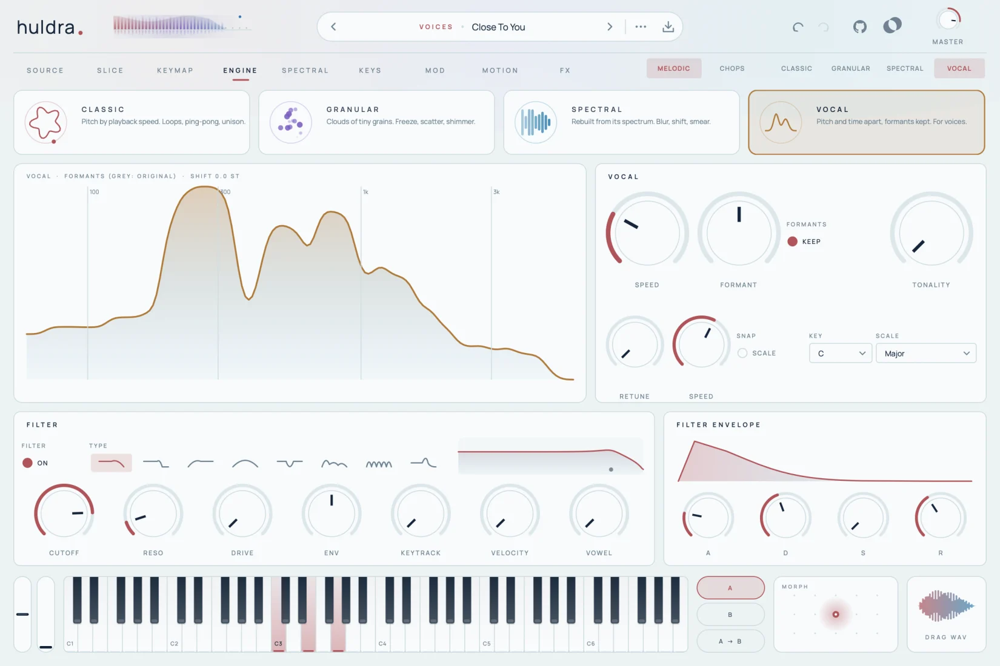
</picture>

Below: the voice filter (12 / 24 dB low pass, high pass, band pass, notch, a **vowel** filter that morphs A–E–I–O–U, a
resonant **comb** and a **ladder**) with its live response curve, the filter envelope, drive and unison.

### Spectral

<picture>
  <source media="(prefers-color-scheme: dark)" srcset="docs/screenshots/spectral-dark.webp">
  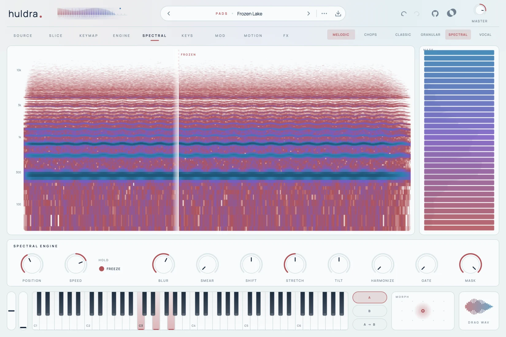
</picture>

The sound as a spectrogram. Drag to choose the moment the spectral engine plays or freezes; paint the **mask** on the
right (32 bands, with the live output spectrum behind) to carve the spectrum. Blur, smear, frequency shift, partial
stretch, tilt, harmonize and a spectral gate turn a voice into glass, metal or air.

### Keys

<picture>
  <source media="(prefers-color-scheme: dark)" srcset="docs/screenshots/keys-dark.webp">
  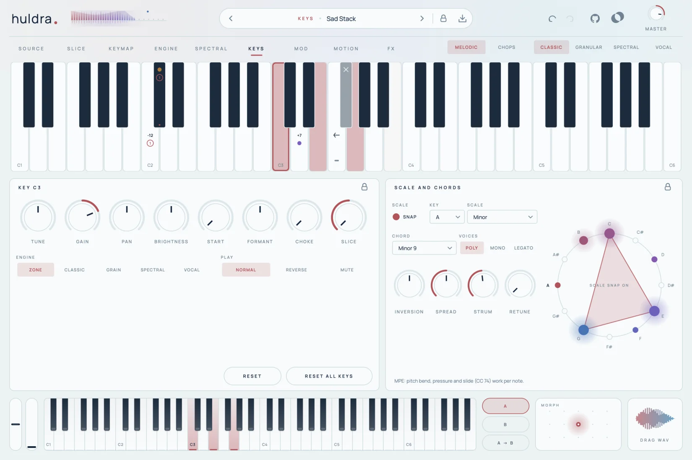
</picture>

Every key can be different: tuning, gain, pan, brightness, start, formant, its own engine or slice, reverse, mute,
a choke group. Select one key, a range (drag) or several (shift-click); edited keys show small marks. On the right,
**scale snap** and the **chord mode** (fifteen chord types including chords that follow the scale, with inversion,
spread and strum) – the wheel shows the scale and draws the chord you play as a star.

### Mod

<picture>
  <source media="(prefers-color-scheme: dark)" srcset="docs/screenshots/mod-dark.webp">
  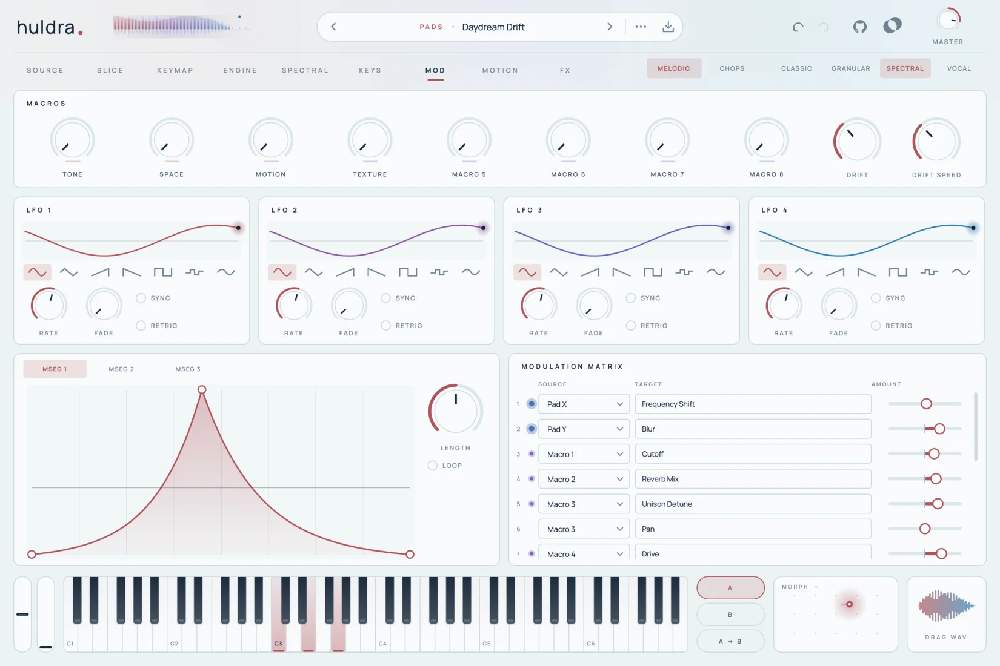
</picture>

Eight macros (double-click a name to rename it), the drift of the morph pad, four LFOs (seven shapes, free or synced,
per note or global, fade in) with their live output, three drawable MSEGs (one-shot or looping) and a sixteen-slot
matrix. Sources: velocity, key, random, pressure, slide, mod wheel, pitch bend, both envelopes, the LFOs, the MSEGs,
the macros, the motion lane and the morph pad. Targets are grouped by area; a dot pulses with each source.

### Motion

<picture>
  <source media="(prefers-color-scheme: dark)" srcset="docs/screenshots/motion-dark.webp">
  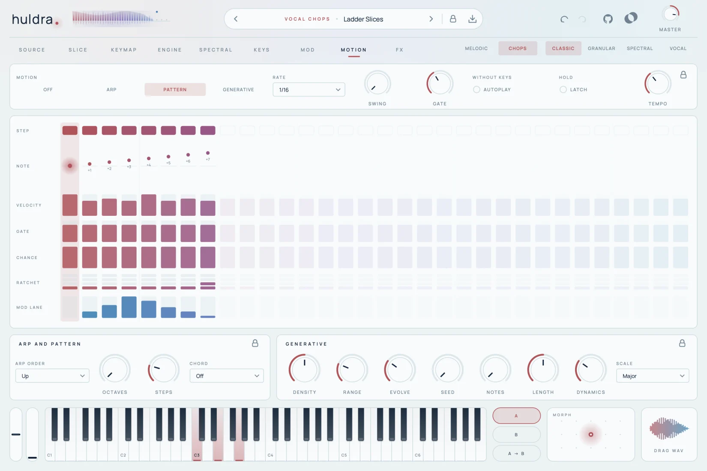
</picture>

What happens while you hold a key – or without one (*Autoplay*): an **arpeggiator** (seven orders, up to four
octaves), a **pattern** of up to 32 steps (note, velocity, gate, chance, ratchets, ties and a mod lane you can route
anywhere) or a **generative** player that wanders through the scale (density, range, evolve, seed – the same seed
plays the same phrase).

<picture>
  <source media="(prefers-color-scheme: dark)" srcset="docs/screenshots/stars-dark.webp">
  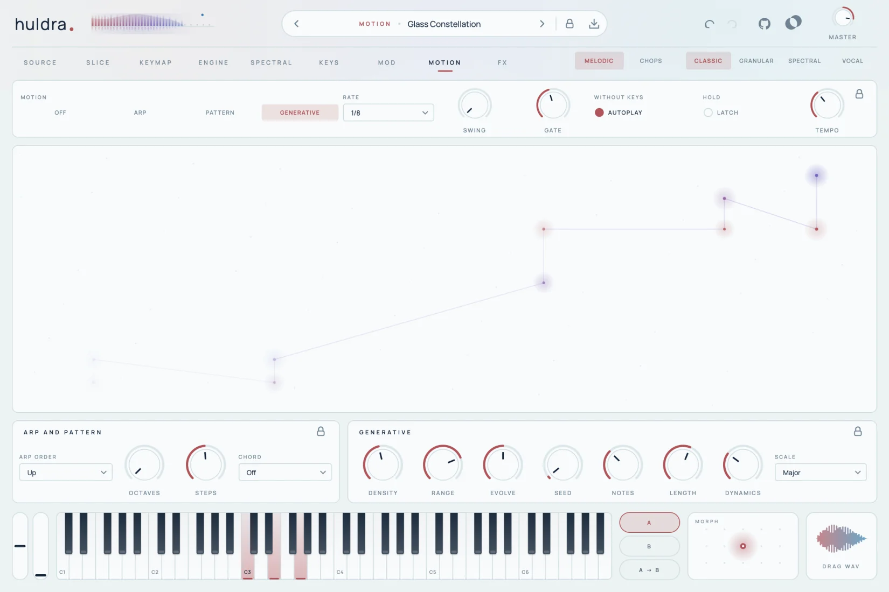
</picture>

### FX

<picture>
  <source media="(prefers-color-scheme: dark)" srcset="docs/screenshots/fx-dark.webp">
  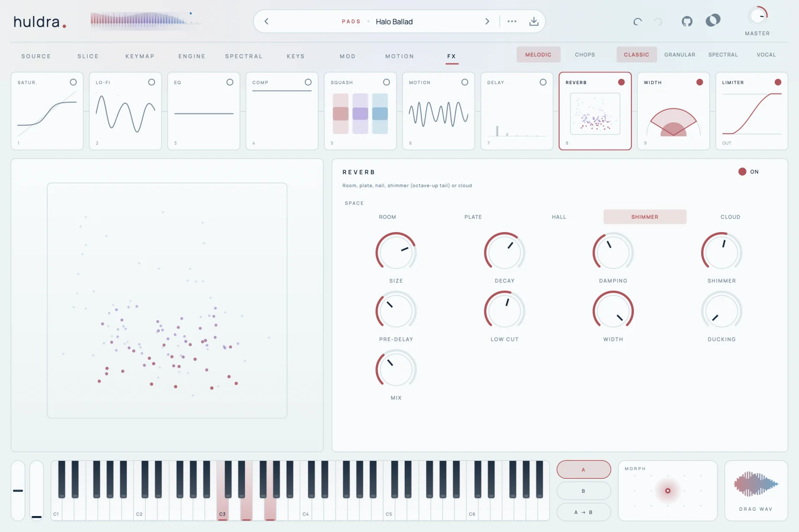
</picture>

The same FX page as in every Fjord plugin: fifteen effects and the clipper as live tiles in two rows – drag them into
any order; the clipper is always last. Every tile shows its effect live (the saturation curve with the signal riding on
it, the compressor's gain reduction, reverb particles that fade with the decay, echo rings …). The selected effect opens
below with a large graph (the EQ points can be dragged, wheel = Q), its controls and its own presets (at least 40
each). **FX CHAIN** loads a whole chain (35 factory chains, saved to `~/Music/Fjord/FX Chains`); **Lock FX** keeps the
effects while you browse sounds.

### Locks

The padlock in the preset bar keeps parts of the treatment while you browse presets: the engine choice, any of the four
engines, the chops, key edits, voice, filter, the envelopes and MSEGs, each LFO, the modulation matrix, macros, the morph
pad, the motion settings (arp, generative, scale, chords, pattern), the whole effect chain or single effects. Small
padlocks sit in the titles of the panels on the pages. Locked parts stay as they are when you load another preset.

### Presets

<picture>
  <source media="(prefers-color-scheme: dark)" srcset="docs/screenshots/browser-dark.webp">
  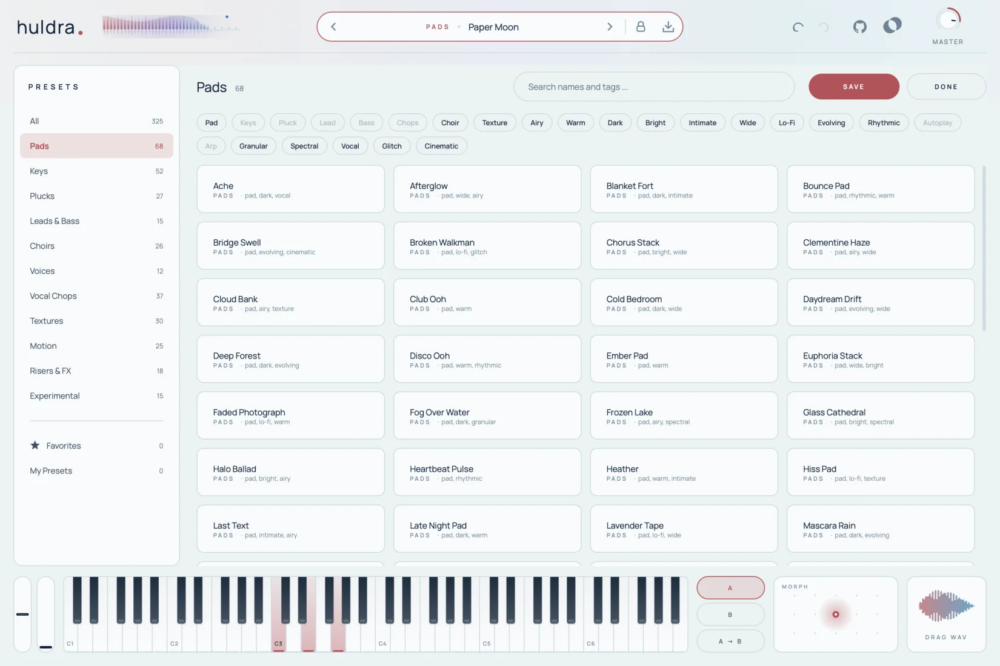
</picture>

### Footer

Pitch and mod wheels, the keyboard, A/B comparison, the **morph pad** (X and Y
are modulation sources; right-click lets it drift on its own) and the WAV export.

## Engines

| Engine | How it plays | Made for |
|---|---|---|
| **Classic** | Resampling with forward and ping-pong loops, crossfades, reverse, unison up to 4 voices; mip-mapped copies keep high notes clean | keys, plucks, stacks, chops |
| **Granular** | Up to 64 grains per voice: position, scan speed, spray, size, density, detune, octave grains, stereo spread, five grain shapes, reverse grains, freeze, jitter | clouds, pads, glitter, frozen moments |
| **Spectral** | Phase-vocoder resynthesis from the analysed spectrum: position and speed apart from pitch, freeze, blur, smear, frequency shift, partial stretch, tilt, harmonize, gate, painted mask | glass, air, frozen choirs, metallic voices |
| **Vocal** | [Signalsmith Stretch](https://github.com/Signalsmith-Audio/signalsmith-stretch): pitch and time independent, formants kept or shifted, tonality limit | natural vocal keys, slow or fast speech, formant play |

Every engine plays the note you press: the test suite measures the output of all four engines with the pitch tracker
(within a third of a semitone). **Retune** pulls the sound's own melody to the scale, smoothly or hard (the classic
auto-tune effect), in the classic and the vocal engine.

## Effects

Huldra uses the effects of [fjord-base](https://github.com/fjord-sounds/fjord-base), the code all Fjord plugins share:
Saturation, Lo-Fi, Transient, Compressor, Squash, EQ, Filter, Motion (chorus, ensemble, phaser, flanger, doubler,
vibrato), Delay, Reverb (room, plate, hall, shimmer, cloud, studio, freeze), Width, Tremolo / Auto-Pan, Frequency
Shifter, Exciter, Harmonizer and the Clipper. Every effect has at least 40 presets and also exists as a plugin of its
own ("Fjord Reverb" …). All parameters:
[fjord-base/docs/effects.md](https://github.com/fjord-sounds/fjord-base/blob/main/docs/effects.md). The filter envelope follows the notes you play.

## Presets

325 factory presets in eleven categories – Pads, Keys, Plucks, Leads & Bass, Choirs, Voices, Vocal Chops, Textures,
Motion, Risers & FX, Experimental – made for the sound of bedroom pop, intimate, emotional pop, polished pop, dance
and house, with room for experiments. All are loudness matched. Each brings its macros (Tone, Space, Motion,
Texture), modulation, often a pattern or an arpeggio; some play by themselves (tag *Autoplay*). The browser has
search, tags and favourites; your own presets go to `~/Music/Fjord/Huldra/Presets`.

## Building

Requirements: CMake 3.22+, a C++20 compiler (Xcode command line tools, Visual Studio 2022 or GCC/Clang on Linux).
Huldra is built on [fjord-base](https://github.com/fjord-sounds/fjord-base), the code all Fjord plugins share (interface,
effects, build helpers): **clone it next to this repository** (`git clone https://github.com/fjord-sounds/fjord-base
../fjord-base`) – without it CMake downloads the release pinned in `CMakeLists.txt` (`FJORD_BASE_TAG`). JUCE 8 comes
through fjord-base.

```bash
git clone https://github.com/fjord-sounds/fjord-base.git
git clone https://github.com/fjord-sounds/huldra.git && cd huldra
cmake -S . -B build -DCMAKE_BUILD_TYPE=Release
cmake --build build -j8
```

On macOS, `./build.sh` builds AU, VST3 and the standalone app, installs the plugins and validates the AU with
`auval`. Linux needs the usual JUCE packages (ALSA, X11, Freetype, fontconfig, GL headers).

## Tests

```bash
cmake --build build --target HuldraRenderTest -j8
./build/HuldraRenderTest_artefacts/Release/HuldraRenderTest build/renders      # must print ALL PASSED
```

The test renders without a DAW and checks: every engine on several sounds (no NaN, no clipping, no hanging notes),
pitch accuracy of all engines, engine features and effects, the analysis (pitch of known tones, transients and
syllables of synthetic signals, the demo voices), chops, all motion modes (and that a seed always plays the same
phrase), odd block sizes, project round trips with embedded audio, the bounce, CPU load with sixteen voices, random
states of all parameters (`HULDRA_FUZZ=<n>` sets how many), and every factory preset. `HULDRA_WAV=1` writes the
renders as WAV files. The plugins also pass [pluginval](https://github.com/Tracktion/pluginval) at strictness 10 and
Apple's `auval`.

## Licence

Huldra is free software under the [GNU Affero General Public License v3](LICENSE). See
[THIRD_PARTY_NOTICES.md](THIRD_PARTY_NOTICES.md) for fjord-base, JUCE, Signalsmith Stretch and the Manrope font.
